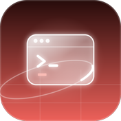
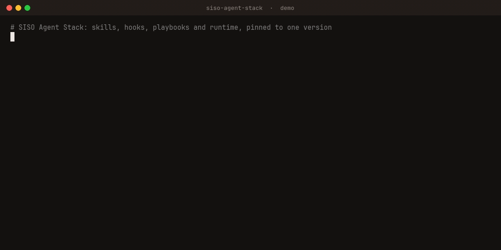
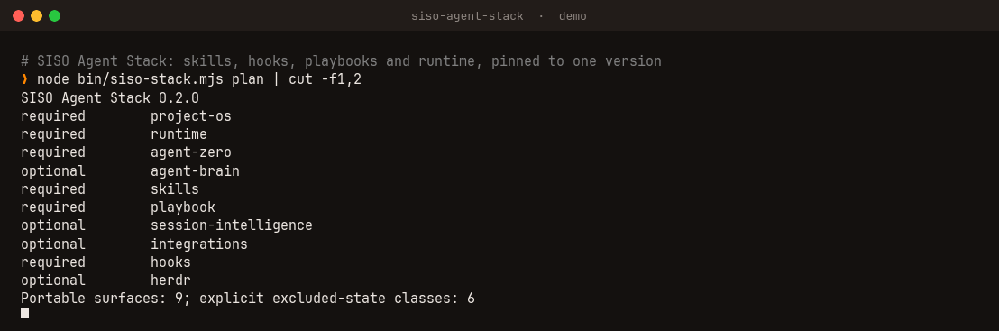
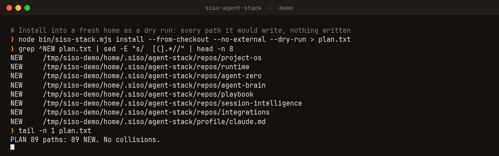
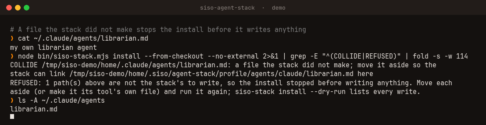

<!-- siso-os:header (generated by sisodias/siso-os-release from repos.json; edit there, not here) -->
<p align="center">
  <a href="https://www.sisolabs.space/agent-base/agent-stack/"></a>
</p>
<h1 align="center">SISO Agent Stack</h1>
<p align="center"><b>One version-pinned Claude Code and Codex stack: skills, hooks, playbooks, profiles and runtime, installed together.</b></p>
<p align="center">
  <a href="https://www.sisolabs.space/agent-base/agent-stack/"></a>
  <a href="https://github.com/siso-os/siso-agent-stack/blob/HEAD/LICENSE"></a>
  <a href="https://github.com/siso-os"></a>
  <a href="https://github.com/siso-os/siso-agent-stack/stargazers"></a>
</p>
<p align="center">
  <a href="https://www.sisolabs.space/agent-base/agent-stack/"></a>
</p>
<p align="center">
  <a href=".github/assets/shot-1.png"></a>
  <a href=".github/assets/shot-2.png"></a>
  <a href=".github/assets/shot-3.png"></a>
</p>
<p align="center">
  <a href="https://www.sisolabs.space/agent-base/agent-stack/"><b>Website</b></a> · <a href="https://docs.sisolabs.space">Docs</a> · <a href="https://github.com/siso-os">Every SISO OS project</a>
</p>

<!-- /siso-os:header -->
One version-pinned distribution for giving another person the reusable SISO Claude Code and Codex setup: skills, hooks, playbooks, agent definitions, global operating profiles, runtime components, coordination services, integrations, and Herdr source.

This repository is intentionally an umbrella installer rather than a duplicated monorepo. Each component keeps its own GitHub identity, license, release cadence, and Great Library Work. `stack.manifest.json` pins the exact composition.

**Ecosystem map:** [SISO Agent Stack in the Great Library](https://great-library-of-siso.vercel.app/works/siso-agent-stack-distribution/) · **Machine contract:** [`stack.manifest.json`](stack.manifest.json) · **Contributing:** [`CONTRIBUTING.md`](CONTRIBUTING.md)

## Install

Prerequisites: Git and Node.js 20 or newer. Python-backed component commands need Python 3. Herdr can be installed separately from its pinned source or with its official installer.

```bash
git clone https://github.com/sisodias/siso-agent-stack.git
cd siso-agent-stack
./install.sh
siso-stack doctor
```

If `~/.local/bin` is not already on your `PATH`, either add it or run `node bin/siso-stack.mjs doctor` from the cloned distribution.

The installer:

- materializes every selected component at an exact commit under `~/.siso/agent-stack/repos/`;
- installs the public Skills Hub and Playbook skills into both `~/.claude/skills/` and `~/.codex/skills/`;
- installs portable researcher, planner, worker, verifier, and refuter definitions in each host's native format: Markdown for Claude Code and standalone TOML for Codex;
- adds marker-managed global Claude and Codex profile blocks while preserving unrelated instructions;
- installs the SISO Hooks package into both host configurations;
- creates command shims under `~/.local/bin/`;
- installs the `siso-stack` command for later planning, verification, and updates;
- writes a machine-readable receipt and verifies it with `doctor`.

Existing unrelated files are never silently overwritten. Before its first write the install checks every target, and if any is a file or link the stack did not make, it names each one and stops without writing anything. It never writes through a link: an instruction file such as `~/.codex/AGENTS.md` that is a link is refused, so the stack's block cannot land in the file the link points at. `compose-brain` (`agents/harness/brain`) regenerates those files and keeps the stack's block.

## Profiles

```bash
./install.sh                    # full public stack, including optional components and Herdr source
./install.sh --required-only    # Project OS, Runtime, Agent Zero, Skills, Playbook, and Hooks
./install.sh --no-external      # omit external Herdr source
./install.sh --dry-run          # list every path the install would write and each collision; writes nothing
```

Use `--home PATH` and `--root PATH` for an isolated install.

**Several Claude accounts on one machine.** If you run Claude Code with more than one `CLAUDE_CONFIG_DIR` (one config dir per account or seat), pass each extra dir with `--claude-dir PATH` (repeatable). Every dir gets the same profile block, agent links, skill links and SISO-managed hooks, all pointing at the one canonical copy under `~/.agents/skills/` and `~/.siso/`. Unmanaged settings and hooks in each dir are left alone. `doctor` remembers the dirs from the receipt and checks each one:

```bash
./install.sh --claude-dir ~/.config/claude-work --claude-dir ~/.config/claude-client
siso-stack doctor
```

`--skills camofox,job-brief` installs exactly those Skills Hub ids on this machine instead of the hub's curated `install_ids` (`--skills curated` goes back). Without `--skills`, a pinned hub that has no curation file is an error, never "install the whole catalogue".

`--hooks safety-guard` (comma-separated ids from SISO Agent Hooks' `hooks.manifest.json`) keeps only those hooks wired in Claude and Codex; the hook payload is still installed in full, and `--hooks all` restores the whole set. A later `./install.sh` with no flags keeps the recorded seats, skill and hook selections and component selection (`--full` widens the components again).

Skill links with an absolute target are treated as externally managed (the stack only writes relative links): skills shipped by the OS or a package, such as Omarchy's `/usr/share/omarchy/default/agents/skills`, or by a project under `~/Projects`. Install and doctor leave them alone. Commands listed under a component's `command_platforms` are only installed on those platforms (`lane-health` and `stack-check` need macOS launchd). Maintainers can use `--source-root PATH` to verify against local checkouts without changing the release pins.

## First five minutes

```bash
siso-stack plan              # show every selected repository and exact commit
siso-stack doctor            # verify pins, profiles, agents, skills, hooks, shims, and receipt
siso-hooks doctor            # inspect the lifecycle-hook installation directly
```

The default install is the complete public stack. Use `--required-only` for the smallest supported core. The installer is idempotent for files it manages and stops on unrelated file collisions instead of overwriting them.

## Update and rollback

The distribution is the lockfile for the whole stack. Releases are tags `stack-<YYYYMMDD>-<HHMM>-<sha8>` on sisodias/siso, published by `siso-stack release` (see CONTRIBUTING.md). Install the newest one, or name an earlier tag to roll back:

```bash
siso-stack install --release latest
siso-stack doctor
```

The release's distribution is fetched into `~/.siso/agent-stack/release/` and installs from there at its own pins, and the `siso-stack` command then runs from it, so a plain `siso-stack install` re-applies that release. Components pinned to the monorepo are fetched as that one commit with only their path checked out, under `~/.siso/agent-stack/repos/monorepo/`. From a clone of this distribution, `git pull --ff-only`, `./install.sh` and `siso-stack doctor` still work. Component checkouts are detached at the exact commits recorded by the release. The installer preserves unrelated host files and creates backups before changing an existing managed profile block.

## What is included

| Layer | Source |
| --- | --- |
| Project operating contract | SISO Project OS |
| Provider-neutral execution | SISO Agent Runtime |
| Intent and coordination | SISO Agent Zero |
| Durable shared state | SISO Agent Brain |
| Atomic capabilities | SISO Skills Hub |
| Multi-agent scenarios and worker tools | SISO Agent Playbook |
| Session learning | SISO Session Intelligence |
| Experimental adapters | SISO Agent Integrations |
| Claude/Codex lifecycle automation | SISO Agent Hooks |
| Persistent terminal runtime | Herdr, external Apache-2.0 Work |

The exact repositories and commit pins are in `stack.manifest.json`.

## Seat limits

`seat-limits/seat-limits.mjs` keeps every agent and its operator in sight of each Claude seat's own plan limits, the
5-hour window, the week and the week's Fable share (% used and reset), so a seat does not die mid-work at its cap.
Where the numbers come from:

- The statusline's JSON input carries `rate_limits.five_hour` and `rate_limits.seven_day` (`used_percentage`,
  `resets_at`), but no Fable share, and the statusline only renders in the interactive terminal.
- So the script reads `GET https://api.anthropic.com/api/oauth/usage` (headers `anthropic-beta: oauth-2025-04-20`),
  the endpoint Claude Code's `/usage` reads, with the seat's own login from `<claude dir>/.credentials.json`. The
  answer's `five_hour` and `seven_day` are `{utilization, resets_at}`, and the Fable share is the `limits[]` row whose
  `scope.model.display_name` is Fable. The token is sent only in that header. It is never printed, never written, and
  never refreshed here (Claude Code refreshes its own).

It runs only when the seat does, never on a timer: as the `statusLine` command (each render), and as
`UserPromptSubmit` and `PostToolUse` hooks, which reach headless and SDK sessions that draw no statusline. A read
happens at most every five minutes per seat (after a failure, five; after a 429, at least ten). Each read writes
`<dir>/<seat>.json` and the merged `<dir>/limits.json`, `{machine, written_at, seats: [{seat, plan, five_hour,
seven_day, fable, resets_at, read_at, error}]}` (default dir `~/SISO_Workspace/_data/seat-limits`). At 80% or more the
agent is told, once per prompt and again when a window crosses 90, 95 or 100: "seat-a weekly Fable 84%, resets
Thu 10:00Z: switch Fable work to Opus".

```bash
node seat-limits/seat-limits.mjs install --seat <name> --claude-dir <dir>   # statusLine + hooks, with a backup
node seat-limits/seat-limits.mjs refresh --seat <name> --claude-dir <dir>   # read now, print the seat's record
node seat-limits/seat-limits.mjs show                                       # print limits.json, every seat merged
```

`install` keeps a seat's own `statusLine` unless `--force`, and replaces only its own hook groups. Tests:
`tests/seat-limits.test.mjs`.

## Explicit privacy boundary

The distribution does not contain provider credentials, Bifrost keys, private network topology, personal memory or lessons, prompt/response bodies, raw transcripts, runtime databases, telemetry, caches, logs, client code, or private project repositories. It installs templates and source; each operator supplies their own accounts and secrets locally.

## Extend the stack

- Add or improve an atomic capability in the [Skills Hub](https://github.com/sisodias/siso-skills-hub).
- Compose multi-agent operating scenarios in the [Agent Playbook](https://github.com/sisodias/siso-agent-playbook-public).
- Add lifecycle policy and automation in [Agent Hooks](https://github.com/sisodias/siso-agent-hooks).
- Propose a new distribution component only when it has an independent adoption, ownership, security, or release boundary.

The Great Library records stable component identity and composition. This repository only pins and installs accepted public releases; it does not absorb their source or ownership.

## Verify

```bash
npm test
npm run verify
node bin/siso-stack.mjs plan
```

MIT licensed. Components retain their own licenses; Herdr remains Apache-2.0 and externally owned.